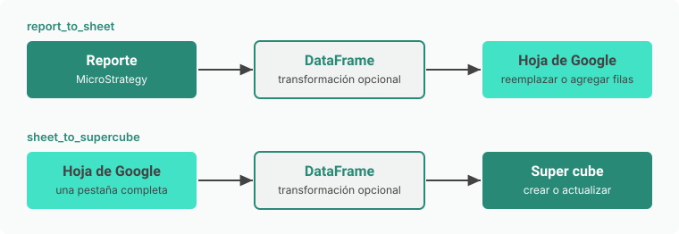

# sm-connectors

Conexiones a MicroStrategy y Google listas para usar, para no reescribirlas en cada proyecto. La librería envuelve los SDK oficiales ([mstrio-py](https://github.com/MicroStrategy/mstrio-py), [gspread](https://github.com/burnash/gspread), google-auth) y suma solo lo que se repite: credenciales, conexión y los flujos que mueven DataFrames entre un sistema y otro.



Cuando el SDK de MicroStrategy agrega algo nuevo, ya lo tenés: la conexión que devuelve la librería es la `Connection` oficial, sin capas en el medio.

<!-- --8<-- [start:instalacion] -->
## Instalación

Requiere Python 3.10 o superior.

```bash
cd strategic-management
python -m venv .venv
.venv\Scripts\activate
pip install -e ".[all]"
```

Para usar la librería desde otro proyecto, instalala en el entorno de ese proyecto con `pip install -e <ruta>/strategic-management[all]`. Si solo necesitás una parte, instalá `[mstr]` o `[google]` en lugar de `[all]`.
<!-- --8<-- [end:instalacion] -->

<!-- --8<-- [start:configuracion] -->
## Configuración

Copiá `.env.example` a `.env` en la raíz del proyecto desde el que ejecutás tus scripts y completalo. Las rutas relativas, como `credentials.json`, se resuelven desde el directorio de trabajo.

| Variable | Obligatoria | Qué es |
|---|---|---|
| `MSTR_BASE_URL` | Sí | URL de MicroStrategy Library, por ejemplo `https://servidor/MicroStrategyLibrary` |
| `MSTR_USER` | Sí | Usuario |
| `MSTR_PASSWORD` | Sí | Contraseña |
| `MSTR_PROJECT_ID` | Sí | ID del proyecto (32 caracteres). Se usa siempre el ID, nunca el nombre |
| `MSTR_LOGIN_MODE` | No | `1` estándar (por defecto) o `16` LDAP |
| `MSTR_FOLDER_ID` | No | Carpeta donde se crean los cubos nuevos. Si falta, van a "My Reports" |
| `GOOGLE_AUTH_MODE` | No | `service_account` (por defecto) u `oauth` |
| `GOOGLE_SERVICE_ACCOUNT_FILE` | Con `service_account` | Ruta al JSON de la service account |
| `GOOGLE_OAUTH_CLIENT_FILE` | Con `oauth` | Ruta al client secret de OAuth |
| `GOOGLE_OAUTH_TOKEN_FILE` | Con `oauth` | Dónde guardar el token (por defecto `token.json`) |

Para que la librería escriba en un Google Sheet con una service account, compartí el Sheet con el `client_email` que figura en el JSON.

El `.env` y los JSON de credenciales están en `.gitignore`. No los subas al repositorio.
<!-- --8<-- [end:configuracion] -->

## Uso

Llevar el resultado de un reporte a una hoja, agregando filas al final y transformando antes de subir:

```python
from sm_connectors.pipeline import report_to_sheet

report_to_sheet("ID_REPORTE", "ID_SHEET", "Historico", mode="append", transform=mi_funcion)
```

Crear un super cube desde una hoja y después mantenerlo actualizado:

```python
from sm_connectors.pipeline import sheet_to_supercube

cube_id = sheet_to_supercube("ID_SHEET", "Hoja 1", "Paises", cube_name="Paises")  # guardá cube_id
sheet_to_supercube("ID_SHEET", "Hoja 1", "Paises", cube_id=cube_id, policy="replace")
```

Usar el SDK de MicroStrategy directamente cuando la librería no tiene lo que necesitás:

```python
from sm_connectors.mstr import mstr_session
from mstrio.project_objects import Report

with mstr_session() as conn:      # cierra la sesión al salir
    df = Report(conn, id="ID_REPORTE").to_dataframe()
```

Hay más ejemplos listos para ejecutar en [examples/](examples/) y recetas explicadas en la [documentación](docs/recetas.md).

## Qué incluye

| Quiero | Función | Módulo |
|---|---|---|
| Conectarme a MicroStrategy | `get_mstr_connection`, `mstr_session` | `mstr` |
| Traer un reporte como DataFrame | `report_to_df` | `mstr` |
| Crear un super cube desde un DataFrame | `create_supercube` | `mstr` |
| Actualizar un super cube (`replace`, `add`, `update`, `upsert`) | `df_to_supercube` | `mstr` |
| Obtener credenciales o clientes de Google | `get_google_credentials`, `get_sheets_client`, `get_google_service` | `google` |
| Leer una pestaña como DataFrame | `sheet_to_df` | `google` |
| Escribir un DataFrame en una pestaña (`replace` o `append`) | `df_to_sheet` | `google` |
| Reporte a hoja, con transformación opcional | `report_to_sheet` | `pipeline` |
| Hoja a super cube, con transformación opcional | `sheet_to_supercube` | `pipeline` |

La referencia completa, con parámetros y comportamiento de cada función, está en la documentación.

## Documentación

```bash
pip install -e ".[docs]"
mkdocs serve
```

Abrí http://127.0.0.1:8000. El historial de versiones está en [CHANGELOG.md](CHANGELOG.md).

## Pruebas

```bash
pytest              # pruebas sin red
pytest -m live      # conexión real a MicroStrategy y Google; requiere el .env
```

Corré `pytest -m live` después de actualizar `mstrio-py` o `gspread`. La versión de `mstrio-py` tiene que ser compatible con tu Intelligence Server.

## Skills

La carpeta [skills/](skills/) contiene los skills asociados al repositorio. Son archivos `SKILL.md` en texto plano, así que sirven con cualquier asistente de IA que los soporte. `sm-connectors` le indica al asistente que use esta librería al iniciar un proyecto, en lugar de reescribir las conexiones.
